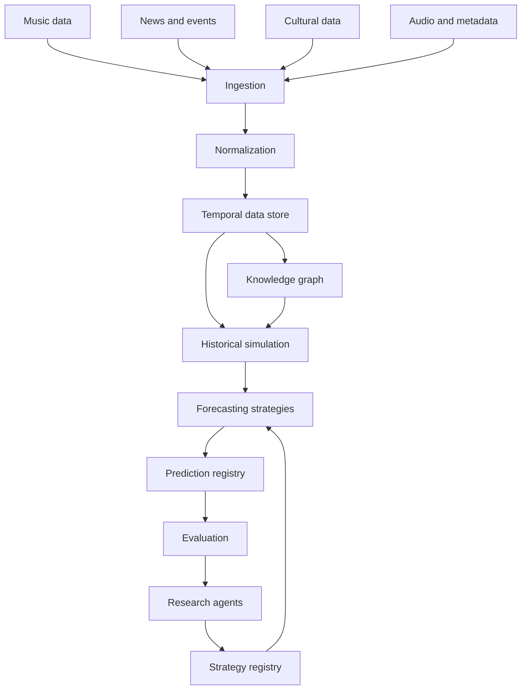

# Point-in-Time Music Forecasting

*Building a historical simulation environment to predict the future of music and culture.*

## Abstract

Every week, millions of people collectively decide which songs become popular. Their decisions are influenced by world events, cultural movements, emerging technologies, social networks, economic conditions, distribution mechanisms and the music itself.

What if we could reconstruct these conditions for every week in modern music history?

We could place an AI agent inside a historical moment, give it access exclusively to information available at that time, and ask it to predict what happens next.

Because the outcomes are already known, we can evaluate its predictions, identify weaknesses, develop new forecasting strategies and repeat the experiment across thousands of historical scenarios.

This project proposes an open-source framework for reconstructing music history, simulating historical environments and developing empirically validated music forecasting systems.

The long-term objective is to build machines capable of understanding how culture evolves and predicting where music is going.

## 1. The hypothesis

Commercial music success is influenced by a complex, interconnected system of variables.

While individual outcomes contain considerable randomness, recurring patterns may exist across:

- Musical characteristics and production techniques.
- Cultural movements and collective sentiment.
- Artist development and audience behavior.
- Distribution and discovery mechanisms.
- Economic and geopolitical conditions.
- Social networks and information propagation.
- Marketing investment and industry activity.

If we can reconstruct these variables with sufficient historical accuracy, we can test whether their relationships contain meaningful predictive signals.

The hypothesis is that music forecasting accuracy can improve through repeated experimentation against historical and prospective outcomes.

## 2. Reconstructing music history

The foundation of the project is a longitudinal, point-in-time dataset representing the state of music and culture.

Every record should contain information about when an event occurred, when it became publicly observable and where the information originated.

The system must be capable of reconstructing what an informed observer could reasonably have known on any supported historical date.

### 2.1 Music performance

| Dataset          | Variables                                        |
| ---------------- | ------------------------------------------------ |
| Charts           | Position, entry date, peak, duration, movement   |
| Streaming        | Daily streams, growth velocity, listener counts  |
| Radio            | Spins, stations, geographic distribution         |
| Playlists        | Additions, removals, positioning, audience reach |
| Video            | Views, engagement, growth velocity               |
| Discovery        | Shazam activity, search volume, social mentions  |
| Sales            | Physical, digital and equivalent units           |
| Live performance | Ticket sales, venue capacity, festival bookings  |

Coverage should extend across countries, genres, platforms and regional markets.

### 2.2 Music composition

Every song should have a machine-readable representation of its musical characteristics.

| Category   | Variables                                      |
| ---------- | ---------------------------------------------- |
| Rhythm     | BPM, time signature, rhythmic complexity       |
| Harmony    | Key, mode, chord progressions                  |
| Structure  | Intro, verse, chorus, bridge, hook placement   |
| Production | Instrumentation, timbre, dynamics, effects     |
| Vocals     | Delivery, melody, range, vocal characteristics |
| Lyrics     | Themes, sentiment, language, vocabulary        |
| Similarity | Audio embeddings, sonic clusters               |
| Credits    | Producers, writers, engineers, collaborators   |

Audio analysis should be reproducible and versioned so researchers can compare different feature extraction methods.

### 2.3 Artist intelligence

An artist's historical state should include their catalog, audience size, growth rate, collaborators, label affiliations, touring activity, geographic concentration, release frequency, press coverage, social engagement and previous commercial performance.

Artist relationships should be represented as a temporal graph, allowing researchers to investigate how creative influence and audience attention propagate through professional and social networks.

### 2.4 Macro culture

Capture the broader conditions under which music is consumed.

| Category             | Examples                                        |
| -------------------- | ----------------------------------------------- |
| Economics            | Inflation, unemployment, consumer confidence    |
| Politics             | Elections, legislation, political movements     |
| World events         | Conflicts, pandemics, natural disasters         |
| Technology           | Smartphones, streaming, social platforms, AI    |
| Demographics         | Population shifts, generational behavior        |
| Collective sentiment | Optimism, anxiety, nostalgia, uncertainty       |
| Seasonality          | Holidays, school calendars, major annual events |

### 2.5 Micro culture

Capture the smaller cultural movements that influence taste and identity.

| Category         | Examples                                         |
| ---------------- | ------------------------------------------------ |
| Internet culture | Memes, viral videos, slang                       |
| Fashion          | Aesthetics, brands, emerging styles              |
| Entertainment    | Film, television, gaming                         |
| Celebrity        | Relationships, controversies, public appearances |
| Communities      | Subcultures, fandoms, online communities         |
| Lifestyle        | Nightlife, fitness, travel, wellness             |
| Social movements | Grassroots trends, identity, cultural discourse  |

Each cultural phenomenon should be represented across its lifecycle: emergence, acceleration, mainstream adoption, saturation, decline and potential resurgence.

### 2.6 Industry activity

Music consumption is also influenced by the systems responsible for distributing and promoting it.

The dataset should capture label signings, marketing expenditure where observable, advertising campaigns, editorial support, influencer activity, radio promotion, sync placements, distribution agreements, release schedules and competing releases.

Where investment or promotional activity cannot be observed, the system must explicitly represent it as missing information.

### 2.7 Consumer behavior

Track how people discover, consume and share music over time.

Relevant variables include platform adoption, listening session behavior, repeat listening, completion rates, skip rates, saves, shares, purchasing behavior, discovery sources and audience migration between genres.

Some of these signals will require partnerships with platforms and rights holders. The framework should support incomplete datasets rather than depend on universal access.

### 2.8 Unsuccessful music

A dataset composed exclusively of successful songs introduces survivorship bias.

The system must also capture music that received little attention, failed to chart, underperformed relative to expectations or declined after initial momentum.

For every successful release, the research environment should contain a representative population of comparable unsuccessful releases.

This enables researchers to investigate why one song succeeded while hundreds of similar songs did not.

## 3. The temporal knowledge graph

Music and culture should be represented as an evolving network of entities, events and relationships.

Relationships are timestamped, versioned and associated with supporting evidence.

The graph should enable research into questions such as:

- How long does an emerging subculture take to influence mainstream music?
- Which cities consistently originate sounds that spread internationally?
- Which producers appear disproportionately early in emerging genres?
- What cultural conditions precede the resurgence of older recordings?
- How do changes in distribution technology affect song structure?
- Which musical characteristics become more popular during periods of economic uncertainty?

Relationships should be treated as testable hypotheses. Correlation alone does not establish causation.

## 4. Historical simulation

The simulation environment allows an agent to operate within a specified historical information boundary.

For example:

```
simulation:
  as_of: 2019-01-01T00:00:00Z
  market: US
  forecast_horizon_days: 90

  objective:
    type: chart_entry
    chart: billboard_hot_100
    candidates: released_non_charting_songs
    prediction_count: 100

  information_boundary:
    enforce: true
    future_data: prohibited
```

The agent receives access to music, artist activity, news, cultural trends and other information observable before the simulation date.

It produces a structured forecast with probabilities, supporting evidence and a defined evaluation horizon.

The environment subsequently reveals the actual outcomes and evaluates the forecast.

**Historical environment**

Reconstruct the world at time t

**Forecasting agent**

Research, reason and predict

**Outcome evaluation**

Compare predictions with observed results

**Research and optimization**

Develop improved forecasting strategies

Repeat across historical periods

The framework should support multiple forecasting approaches, including statistical models, machine learning, large language models, graph neural networks, multimodal models and autonomous research agents.

## Open-Source Technical Specification

Version 0.1.0 · Draft RFC · Apache-2.0

## 5. System architecture

The framework should be modular, model-agnostic and independent of individual data providers.



The framework consists of six primary systems.

| System           | Responsibility                                       |
| ---------------- | ---------------------------------------------------- |
| Ingestion        | Collect and normalize historical information         |
| Temporal storage | Reconstruct information available at a specific time |
| Simulation       | Enforce historical information boundaries            |
| Forecasting      | Generate structured predictions                      |
| Evaluation       | Measure predictive performance                       |
| Research         | Develop and test improved forecasting strategies     |

## 6. Data specification

### 6.1 Temporal record

Every observation must conform to a common temporal record format.

```
interface TemporalRecord {
  id: string;
  entity_id: string;
  entity_type: string;
  event_type: string;

  occurred_at: string;
  available_at: string;
  ingested_at: string;

  source: {
    provider: string;
    reference: string;
    license: string;
    confidence?: number;
  };

  geography?: string[];
  payload: Record<string, unknown>;
  schema_version: string;
}
```

The distinction between `occurred_at` and `available_at` is critical.

A chart report describing activity during January may not become available until February. An agent operating in January must not have access to that report.

Records with uncertain availability dates should be excluded from strict historical benchmarks.

### 6.2 Entity types

The initial specification supports:

```
type EntityType =
  | "song"
  | "recording"
  | "composition"
  | "artist"
  | "songwriter"
  | "producer"
  | "label"
  | "publisher"
  | "genre"
  | "playlist"
  | "chart"
  | "platform"
  | "market"
  | "community"
  | "cultural_trend"
  | "world_event"
  | "campaign";
```

Recordings and compositions should have separate identities. Multiple recordings of the same composition may experience entirely different commercial outcomes.

### 6.3 Chart observation

```
{
  "entity_type": "recording",
  "event_type": "chart_observation",
  "occurred_at": "2019-01-07T00:00:00Z",
  "available_at": "2019-01-08T00:00:00Z",
  "payload": {
    "recording_id": "example_recording",
    "chart_id": "example_chart",
    "market": "US",
    "position": 47,
    "previous_position": 82,
    "peak_position": 47,
    "weeks_on_chart": 3
  }
}
```

### 6.4 Cultural observation

```
{
  "entity_type": "cultural_trend",
  "event_type": "trend_observation",
  "occurred_at": "2024-02-01T00:00:00Z",
  "available_at": "2024-02-02T00:00:00Z",
  "payload": {
    "name": "example_aesthetic",
    "category": "fashion",
    "markets": ["US", "GB"],
    "signals": {
      "mention_count": 42000,
      "weekly_growth": 0.34
    },
    "related_entities": [],
    "lifecycle_stage": "emerging"
  }
}
```

Derived observations, including sentiment scores and lifecycle classifications, must identify the model or algorithm responsible for generating them.

## 7. Historical data sources

The project should implement interchangeable provider adapters.

| Domain              | Potential sources                             |
| ------------------- | --------------------------------------------- |
| Charts              | Billboard, Official Charts, Spotify Charts    |
| Music analytics     | Songstats, Chartmetric, Luminate              |
| Music metadata      | MusicBrainz, Discogs                          |
| Audio analysis      | Essentia, librosa, licensed audio collections |
| Historical web      | Internet Archive, Common Crawl                |
| Global news         | GDELT, historical news archives               |
| Search behavior     | Google Trends                                 |
| Cultural activity   | Reddit, YouTube, TikTok, Wikipedia            |
| Economic conditions | FRED, World Bank, OECD                        |
| Film and television | TMDB, historical box office datasets          |
| Research datasets   | Million Song Dataset, academic music datasets |

These are candidate sources. Historical depth, API access, commercial usage rights and redistribution permissions require independent verification.

The framework must remain functional without any specific commercial provider.

## 8. Forecasting protocol

All forecasting strategies should implement a standardized interface.

```
interface ForecastingStrategy {
  id: string;
  version: string;

  predict(
    context: SimulationContext,
    task: ForecastTask
  ): Promise<Forecast[]>;
}
```

Each forecast must contain a measurable outcome, a probability and an evaluation deadline.

```
interface Forecast {
  id: string;
  strategy_id: string;
  strategy_version: string;

  entity_id: string;
  generated_at: string;
  as_of: string;
  resolves_at: string;

  outcome: {
    type: string;
    parameters: Record<string, unknown>;
  };

  probability: number;
  evidence_ids: string[];
  rationale?: string;
}
```

Example prediction:

```
{
  "entity_id": "recording_123",
  "as_of": "2024-01-01",
  "resolves_at": "2024-04-01",
  "outcome": {
    "type": "chart_entry",
    "parameters": {
      "chart": "billboard_hot_100"
    }
  },
  "probability": 0.73,
  "evidence_ids": [
    "streaming_growth_456",
    "cultural_trend_789",
    "artist_trajectory_101"
  ]
}
```

This prediction can be evaluated objectively once the forecast horizon concludes.

## 9. Benchmark suite

The project should establish standardized benchmarks that allow researchers to compare forecasting strategies.

| Benchmark        | Objective                                | Horizon  |
| ---------------- | ---------------------------------------- | -------- |
| `HIT-100`        | Predict new chart entries                | 90 days  |
| `BREAKOUT`       | Predict emerging artist breakouts        | 180 days |
| `PEAK`           | Predict a song's peak chart position     | 90 days  |
| `LONGEVITY`      | Predict sustained commercial performance | 365 days |
| `RESURGENCE`     | Predict renewed catalog consumption      | 180 days |
| `GENRE-SHIFT`    | Predict changes in genre market share    | 365 days |
| `GEO-SPREAD`     | Predict geographic expansion             | 90 days  |
| `CATALOG-GROWTH` | Predict catalog consumption growth       | 365 days |
| `SONIC-TREND`    | Predict emerging musical characteristics | 365 days |
| `CULTURE-SHIFT`  | Predict cultural trend adoption          | 180 days |

Each benchmark must define its candidate population, eligibility requirements, outcome criteria, evaluation window and missing-data policy before experiments begin.

### 9.1 Evaluation metrics

| Metric       | Purpose                                                            |
| ------------ | ------------------------------------------------------------------ |
| Precision\@K | Percentage of selected candidates that succeed                     |
| Recall\@K    | Percentage of successful candidates identified                     |
| Lift         | Improvement over baseline selection                                |
| Brier score  | Accuracy of predicted probabilities                                |
| Log loss     | Probability accuracy, penalizing overconfidence                    |
| NDCG         | Quality of ranked predictions                                      |
| MAE          | Accuracy of numerical forecasts                                    |
| Calibration  | Agreement between predicted probabilities and observed frequencies |

### 9.2 Baselines

Every forecasting strategy must be compared against appropriate baselines.

Initial baselines should include random selection, current popularity, recent growth velocity, historical artist performance, logistic regression and gradient-boosted trees.

A complex agentic system should demonstrate measurable improvement over simpler approaches before its additional computational cost is justified.

### 9.3 Example evaluation

The following results are illustrative, not measured.

### HIT-100 benchmark

Hypothetical experiment · 100 predictions per strategy

Random selection

2%

Current popularity

12%

Growth velocity

19%

Traditional ML

28%

Multimodal forecasting

37%

Agentic forecasting

44%

Illustrative Precision\@100. Actual relative performance must be established experimentally.

## 10. Preventing temporal contamination

Historical forecasting introduces a fundamental research problem: modern AI models may already know the outcomes they are being asked to predict.

Restricting internet access to historical information does not remove knowledge encoded in model weights.

The framework should implement several safeguards.

- **Point-in-time retrieval:** All retrieved information must have been available before the simulation date.
- **Entity anonymization:** Replace recognizable artist names, song titles and other identifying information where feasible.
- **Temporal model checkpoints:** Use models with documented training cutoffs preceding the forecast period.
- **Walk-forward validation:** Train on earlier periods and evaluate on subsequent periods.
- **Locked holdout datasets:** Prevent research agents from repeatedly optimizing against final evaluation periods.
- **Prospective evaluation:** Register predictions about unresolved future events and evaluate them when outcomes become available.

Anonymization reduces some forms of contamination but cannot guarantee their elimination. Audio, lyrics and distinctive historical circumstances may still reveal identities.

Historical simulations should be treated as research environments. Prospective forecasting should serve as the strongest evidence of genuine predictive ability.

## 11. Autonomous research agents

The framework should support continuously operating research agents that improve forecasting strategies through experimentation.

Each research agent receives an objective, computational budget, training environment and evaluation protocol.

```
research_agent:
  objective: maximize_out_of_sample_forecasting_accuracy

  benchmark: HIT-100

  allowed_actions:
    - generate_hypothesis
    - develop_features
    - implement_strategy
    - execute_backtest
    - compare_baselines
    - register_experiment

  constraints:
    temporal_leakage: prohibited
    holdout_access: prohibited
    reproducibility: required

  execution:
    mode: continuous
    max_parallel_experiments: 10
    budget_usd_per_day: 25
```

The budget and concurrency settings above are illustrative configuration values.

### 11.1 Research loop

```python
while budget.remaining():
    hypothesis = researcher.generate_hypothesis(previous_experiments)
    strategy = researcher.implement(hypothesis)
    results = simulator.backtest(strategy, training_periods)
    validation = evaluator.validate(strategy, validation_periods)
    registry.record(hypothesis, strategy, results, validation)
    if evaluator.qualifies_for_promotion(validation):
        registry.promote(strategy)
```

Research agents should be able to independently develop new features, discover relationships, propose statistical models and test combinations of existing strategies.

Every experiment, including failed experiments, should be recorded.

Over time, the project accumulates a growing body of reproducible research about music consumption and cultural evolution.

## 12. Research tracks

The framework should support independent research programs operating against shared infrastructure.

| Research track          | Example hypothesis                                                        |
| ----------------------- | ------------------------------------------------------------------------- |
| Sonic evolution         | Changes in popular song structure precede genre transitions               |
| Cultural propagation    | Emerging aesthetics influence music consumption with measurable delays    |
| Artist networks         | Collaborator relationships predict emerging artist success                |
| Geographic diffusion    | Certain cities consistently precede global genre adoption                 |
| Nostalgia cycles        | Generational behavior predicts catalog resurgence                         |
| Economic sentiment      | Economic conditions influence lyrical and sonic preferences               |
| Platform evolution      | Changes in discovery mechanisms influence composition                     |
| Attention saturation    | Audience fatigue predicts declining genre momentum                        |
| Release timing          | Competition and cultural conditions influence release performance         |
| Catalog intelligence    | Early cultural signals predict future catalog consumption                 |
| Audience migration      | Communities move between artists and genres in identifiable patterns      |
| Marketing effectiveness | Different promotional mechanisms work under different cultural conditions |

Marketing effectiveness requires separate causal research methods, such as randomized experiments or credible quasi-experimental designs. Forecasting accuracy alone cannot establish the incremental impact of a campaign.

## 13. Repository structure

```
music-forecasting/
├── README.md
├── SPEC.md
├── LICENSE
├── CONTRIBUTING.md
│
├── schemas/
│   ├── temporal-record.json
│   ├── recording.json
│   ├── cultural-event.json
│   ├── forecast.json
│   └── experiment.json
│
├── providers/
│   ├── charts/
│   ├── streaming/
│   ├── metadata/
│   ├── news/
│   ├── culture/
│   └── economics/
│
├── packages/
│   ├── ingestion/
│   ├── normalization/
│   ├── temporal-store/
│   ├── knowledge-graph/
│   ├── audio-analysis/
│   ├── simulation/
│   ├── evaluation/
│   └── sdk/
│
├── benchmarks/
│   ├── hit-100/
│   ├── breakout/
│   ├── resurgence/
│   └── genre-shift/
│
├── strategies/
│   ├── baselines/
│   ├── statistical/
│   ├── machine-learning/
│   └── agentic/
│
├── agents/
│   ├── forecasting/
│   ├── research/
│   └── evaluation/
│
├── experiments/
├── datasets/
│   ├── manifests/
│   └── synthetic/
│
├── leaderboard/
├── tests/
└── docs/
```

## 14. Proposed developer interface

The framework should expose a CLI, SDK and API.

The following commands represent the proposed interface. They are not implemented.

**Ingest historical data**

```
music-forecast ingest \
  --provider musicbrainz \
  --from 2015-01-01 \
  --to 2025-12-31
```

**Reconstruct a historical environment**

```
music-forecast snapshot \
  --date 2019-01-01 \
  --market US
```

**Run a historical benchmark**

```
music-forecast backtest \
  --benchmark hit-100 \
  --strategy momentum \
  --from 2020-01-01 \
  --to 2024-12-31 \
  --interval weekly
```

**Launch an autonomous research agent**

```
music-forecast research \
  --benchmark hit-100 \
  --budget 25 \
  --continuous
```

**Register a prospective forecast**

```
music-forecast predict \
  --benchmark hit-100 \
  --strategy best-validated \
  --horizon 90 \
  --register
```

**Compare experimental results**

```
music-forecast leaderboard \
  --benchmark hit-100
```

## 15. Reference technology stack

The specification should remain implementation-independent. An initial reference implementation could use:

| Component               | Technology                |
| ----------------------- | ------------------------- |
| Application and SDK     | TypeScript                |
| Research and modeling   | Python                    |
| Entity storage          | PostgreSQL                |
| Historical observations | Apache Parquet            |
| Analytical queries      | DuckDB                    |
| Object storage          | S3-compatible storage     |
| Vector search           | pgvector                  |
| Audio analysis          | Essentia, librosa         |
| Agent orchestration     | Pluggable agent harnesses |
| Experiment tracking     | MLflow                    |
| Model execution         | Local and hosted models   |
| Interface               | CLI, REST API, MCP server |
| Deployment              | Docker                    |

A local implementation should be sufficient to run initial experiments. Distributed infrastructure can be introduced as dataset size and computational requirements increase.

## 16. Open-source governance

The project should adopt an open research model.

Researchers, engineers, artists, labels, publishers and independent developers should be able to contribute data adapters, feature extraction methods, benchmarks, forecasting strategies and research findings.

The following components should be publicly available:

- Data schemas and provider interfaces.
- Simulation and evaluation infrastructure.
- Benchmark definitions and baseline strategies.
- Reproducible experiment configurations.
- Research findings and performance leaderboards.
- Synthetic and legally redistributable datasets.

Commercially licensed datasets, copyrighted recordings, confidential industry information and proprietary customer data must remain subject to their respective access and licensing restrictions.

Open-source software licensing does not grant permission to redistribute third-party music or data.

## 17. Public forecasting leaderboard

The project should maintain two independent leaderboards.

**Historical leaderboard:** Measures performance against standardized historical benchmarks, with documented contamination controls.

**Live leaderboard:** Measures predictions registered before their outcomes become known.

Every leaderboard submission should include the strategy version, dataset version, prediction timestamp, evaluation methodology, computational cost and reproducibility information.

The live leaderboard should eventually become the primary measure of forecasting performance.

Researchers should be able to compete across different forecast horizons, genres, geographic markets and research tracks.

## 18. Implementation roadmap

### 01. Historical music dataset

Establish entity resolution, chart ingestion, temporal schemas and historical release populations. Target 2015–2025, subject to data availability.

### 02. Simulation and benchmarks

Implement point-in-time retrieval, HIT-100, baseline forecasting strategies and reproducible walk-forward testing.

### 03. Cultural intelligence

Integrate historical news, macroeconomic conditions, internet culture and emerging cultural trends.

### 04. Multimodal music intelligence

Introduce audio embeddings, lyrical analysis, musical characteristics and artist relationship graphs.

### 05. Autonomous research

Deploy research agents that independently generate hypotheses, develop forecasting strategies and evaluate their performance.

### 06. Live forecasting network

Launch public forecasting benchmarks, immutable prediction registration and community leaderboards.

## 19. Initial experiment

The first experiment should deliberately limit the number of variables.

**Objective:** Every week, identify 100 previously released songs that have never entered the Billboard Hot 100 and are most likely to enter it within the next 90 days.

The candidate population must include unsuccessful releases, with eligibility established using information available at the prediction date.

Run the experiment across hundreds of historical weeks.

Begin with music performance data alone. Subsequently introduce artist intelligence, audio characteristics, cultural trends and macroeconomic information as separate experimental layers.

Measure the incremental predictive value of each layer through ablation studies.

### Experimental progression

Each experiment adds a new information layer.

01

Music performance

02

\+ Artist intelligence

03

\+ Audio and composition

04

\+ Industry activity

05

\+ Micro culture

06

\+ Macro culture

07

\+ Autonomous research

This experiment should establish whether cultural information provides measurable predictive value beyond conventional music analytics.

A negative result would also be valuable. It would identify which information is expensive to collect without materially improving forecasts.

## 20. Long-term vision

A mature music forecasting system could support a wide range of applications:

| Stakeholder         | Application                                         |
| ------------------- | --------------------------------------------------- |
| Record labels       | Identify emerging artists and recordings            |
| Publishers          | Discover songwriters and emerging creative networks |
| Catalog investors   | Forecast future consumption and earnings            |
| Artists             | Understand emerging audience preferences            |
| Producers           | Identify evolving musical characteristics           |
| Marketing teams     | Anticipate cultural opportunities                   |
| Streaming platforms | Improve discovery and recommendation                |
| Researchers         | Understand the mechanisms of cultural evolution     |

The broader opportunity extends beyond music.

Music provides a uniquely measurable environment for studying human taste. Songs are released continuously, consumption is observable, cultural influences are widespread, and commercial outcomes can be measured across time and geography.

By reconstructing historical environments and continuously testing predictions against reality, we can develop a better understanding of how collective human preferences evolve.

Every week generates new training examples. Every forecast generates a new experiment. Every failed prediction creates an opportunity to improve.

The objective is to establish an open, continuously improving scientific framework for predicting the future of music and, eventually, culture itself.

**Specification status:** This is a proposed research framework, not an implemented repository. The technology stack, historical coverage, benchmark definitions and CLI interfaces are proposed design decisions. Data access, licensing, historical completeness and achievable forecasting accuracy remain unresolved.
